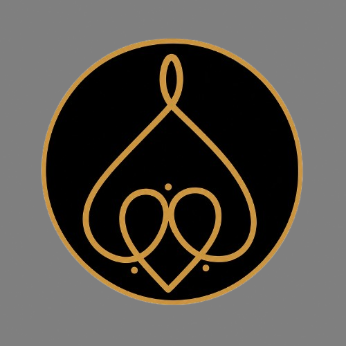



  

  # Encontro d'Água Hub
  ### *Reflorestando o Digital com Inteligência Artificial, Automação e Tecnologia Sustentável*

  

    <strong>Holding & Agência AI-Native</strong> focada em estruturar processos, criar soluções inteligentes e transformar negócios reais através de Agentes de IA, Engenharia de Dados e Presença Digital.
  

  

    
    
    
  

---

## 🌊 Sobre o Ecossistema

Inspirado na força e na fluidez do Encontro das Águas amazônico, o **Encontro d'Água Hub** foi fundado por **[Lídi Moura](https://github.com/lidimoura)** para integrar tecnologia de ponta com sustentabilidade operacional. Atuamos desde a modelagem de negócios e análise de dados até o deploy de agentes autônomos e produtos digitais completos.

### 👩‍💻 Liderança & Fundamentação Técnica
* 🏆 **Líder Técnica Campeã (1º Lugar)** no Hackathon ONE G9 (NoCountry / Alura / Oracle) com o projeto *PowerPolis (EnergiAI)*.
* 🤖 **Criadora da Amazô.guia G10:** Agente conversacional SDR com arquitetura RAG (Retrieval-Augmented Generation), fontes de verdade sanitizadas e curadoria documental para o Challenge G10.
* 🎓 **Formação Especializada ONE (Oracle Next Education + Alura):**
  * **G9:** Data Science & Engenharia de Dados (ETL, Python, Machine Learning).
  * **G10:** IA for Tech (Engenharia de Agentes, Bancos Vetoriais, LangChain, OCI AI).
  * **G11:** IA for Business (Modelagem Estratégica de Negócios, StartSe AI Canvas, Automações Comerciais).
* 📜 **Certificações Oficiais:** *Parceira Certificada Kommo CRM*, *Oracle Cloud Infrastructure (OCI) Foundations & AI Associate*, *Power BI (Fundação Bradesco)*.

---

## 🧠 Arquitetura Hub OS

O Hub é orquestrado pelo **Hub OS**, um sistema operacional modular e colaborativo entre inteligências artificiais e especialistas humanos:

`mermaid
flowchart TD
    NEXUS["🧠 hub-os-nexus\n(Núcleo de Governança, Regras de Negócio e Holding)"]
    GUIA["🧭 hub-os-guIA\n(Guia Técnico, Mentoria, Templates e Métodos STAR)"]
    AMAZO["📚 amazo-guia-g10\n(Fontes de Verdade, RAG SDR e Curadoria Documental)"]
    CENTRAL["📋 ClickUp & Make\n(Pipeline Operacional e Orquestração Multi-LLM)"]
    
    NEXUS <--> GUIA
    NEXUS --> AMAZO
    GUIA --> CENTRAL
    CENTRAL --> CLIENTES["🚀 Soluções Entregues (Sites Lovable · Agentes GPTMaker · CRM Kommo)"]
`

* **hub-os-nexus:** Núcleo privado responsável pela governança corporativa, diretrizes de segurança (RBAC/LGPD), esteira de dados e regras de negócio da holding.
* **hub-os-guIA:** Motor de mentoria técnica, condução de reuniões, geração de PRDs, documentação contínua via DevLogs e curadoria de métricas STAR.
* **mazo-guia-g10:** Fonte de verdade documental e base de conhecimento para criação de agentes RAG aplicados a negócios.

---

## 🤝 Modelos de Atuação & Serviços

Atendemos negócios em diferentes níveis de maturidade digital através de três formatos:

| Formato | Proposta de Valor | Entregáveis Principais |
| :--- | :--- | :--- |
| 🚀 **Full Service** *(Done-For-You)* | Construção e entrega ponta a ponta pela nossa equipe técnica | • Sites e Landing Pages de alta conversão (Lovable / Web) • Cartões Digitais e QR Codes Dinâmicos ([Link d'Água](https://link.encontrodagua.com)) • Agentes de IA 24/7 no WhatsApp/Instagram (GPTMaker + Kommo CRM) |
| 🤝 **Together** *(Done-With-You)* | Implementação conjunta a quatro mãos e mentoria técnica | • Sessões mão na massa de automação de processos (Make / APIs) • Estruturação de funis no Kommo CRM com acompanhamento • Mapeamento de gargalos e arquitetura de dados |
| 🎓 **Teach** *(Capacitação)* | Capacitação estratégica para líderes e equipes operacionais | • Consultoria & Diagnóstico Express (sessão de 60 min via Google Meet) • Treinamento de Engenharia de Prompts e uso prático de LLMs • Combos formativos personalizados para o time do cliente |

> 🎁 **Bônus Hub:** Todo projeto ou consultoria fechada conta com um **QR Code Dinâmico permanente** e um **Cartão de Visita Digital profissional** integrados como cortesia de boas-vindas.

---

## 🛠️ Stack Tecnológico Oficial

  
  
  
  
  
  
  
  
  
  
  
  

---

## 📬 Conecte-se com o Hub

Pronta para diagnosticar seus gargalos, desenhar seu roadmap de IA ou automatizar seu atendimento comercial:

* 🗓️ **Agende um Diagnóstico:** [calendar.app.google/C2D9x5Tbswsj1Poo6](https://calendar.app.google/C2D9x5Tbswsj1Poo6)
* 💬 **WhatsApp Oficial:** [+55 (41) 99255-7600](https://wa.me/5541992557600)
* 📧 **E-mail Corporativo:** [encontrodaguahub@gmail.com](mailto:encontrodaguahub@gmail.com)
* 🌐 **Portfólio & Soluções:** [link.encontrodagua.com](https://link.encontrodagua.com)

  © 2026 Encontro d'Água Hub. Desenvolvido com inteligência, transparência e impacto social.

